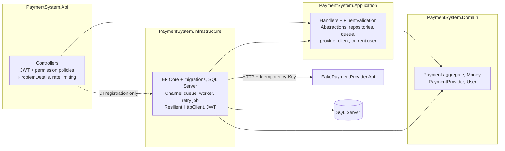
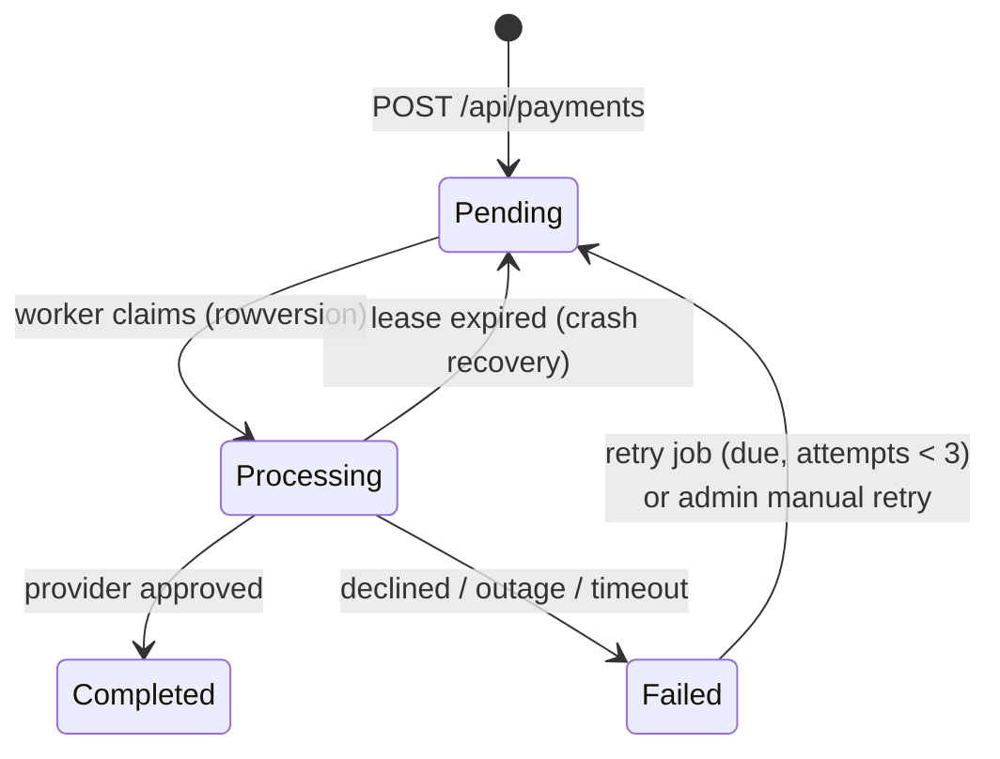

# PaymentSystem

Payment processing and compliance API built with **ASP.NET Core (.NET 10)**, **EF Core 10** and **SQL Server**. It is organized as Clean Architecture with a DDD domain model.

Users submit payments and get `201 Pending` immediately. A background worker sends each payment to an external provider over a resilient HTTP client and marks it `Completed` or `Failed`. A recurring job retries failed payments with exponential backoff. Admins manage providers, retry failures manually and read a daily report that comes from a stored procedure.

- [Quick start](#quick-start)
- [Architecture](#architecture)
- [Key design decisions](#key-design-decisions)
- [API](#api)
- [Reviewer walkthrough (Swagger)](#reviewer-walkthrough-swagger)
- [Database](#database)
- [Reporting and the MySQL equivalent](#reporting-and-the-mysql-equivalent)
- [Testing](#testing)
- [Configuration](#configuration)
- [Known limitations](#known-limitations)

## Quick start

**Prerequisites**
- [.NET 10 SDK](https://dotnet.microsoft.com/download/dotnet/10.0)
- SQL Server **LocalDB** (installed with Visual Studio's *ASP.NET and web development* workload) or any SQL Server
- Optional: Visual Studio 2026 for IIS Express debugging

```powershell
git clone https://github.com/bekiraknci/PaymentProcess.git
cd PaymentProcess
dotnet tool restore
```

**Visual Studio**
1. Open `PaymentSystem.slnx`.
2. Select the **Api + FakePaymentProvider** startup profile (defined in `PaymentSystem.slnLaunch`).
3. Press **F5**.

**Command line** (two terminals)

```powershell
dotnet run --project src/FakePaymentProvider.Api --launch-profile http
```

```powershell
dotnet run --project src/PaymentSystem.Api --launch-profile http
```

| Service | URL |
|---|---|
| PaymentSystem API, Swagger UI | http://localhost:5000/swagger |
| FakePaymentProvider ("Service B") | http://localhost:5100 |
| Health | http://localhost:5000/health/live, http://localhost:5000/health/ready |

In Development the API applies all migrations on startup, so the database, seed data and the report stored procedure are created automatically. To create them manually:

```powershell
dotnet ef database update -p src/PaymentSystem.Infrastructure -s src/PaymentSystem.Api
```

**Test accounts** (seeded)

| Email | Password | Role | Permissions |
|---|---|---|---|
| `admin@test.com` | `Admin123!` | Admin | `Payments.Create`, `Payments.View`, `Payments.Process`, `Providers.Manage` |
| `user@test.com` | `User123!` | User | `Payments.Create`, `Payments.View` |
| `user2@test.com` | `User123!` | User | `Payments.Create`, `Payments.View` |

**Seeded providers**

| Code | Id | State |
|---|---|---|
| `FAKEPAY` | `0196a000-0000-7000-8000-000000000001` | active, EUR/GBP/TRY/USD |
| `LEGACYPAY` | `0196a000-0000-7000-8000-000000000002` | inactive, TRY |

## Architecture



Dependencies point inward. **Domain** references no other project and no package. **Application** knows only the domain and its own abstractions. **Infrastructure** implements those abstractions. **Api** wires everything and maps results to HTTP.

```
src/
  PaymentSystem.Domain/          Aggregates, value objects, domain rules
  PaymentSystem.Application/     Use-case handlers, validators, abstractions, DTOs
  PaymentSystem.Infrastructure/  EF Core, migrations, queue, worker, retry job, provider client, JWT
  PaymentSystem.Api/             Controllers, request contracts, auth, rate limiting, Swagger
  FakePaymentProvider.Api/       Stand-alone simulated payment provider
tests/
  PaymentSystem.Domain.Tests/          Domain unit tests
  PaymentSystem.Application.Tests/     Use-case tests with in-memory fakes
  PaymentSystem.Api.IntegrationTests/  Functional, security, database, load and end-to-end tests
sql/mysql/daily_payment_report.sql     MySQL equivalent of the report
```

### Payment lifecycle



Every transition goes through a method on the `Payment` aggregate, which rejects illegal transitions, writes a `PaymentStatusHistory` row and raises a domain event.

## Key design decisions

| Decision | Why |
|---|---|
| **Clean Architecture + DDD.** Rich `Payment` aggregate, `Money` value object, state changes only through domain methods. | Business rules live in one place and are unit-testable without infrastructure. |
| **Plain handler classes instead of MediatR.** | The flow stays explicit and easy to debug; there is no reflection pipeline for a handful of use cases. |
| **Hybrid queue.** The database is the source of truth; an in-memory `Channel<Guid>` is the fast signal. | `POST` returns immediately. If the signal is lost (restart, full queue), the worker's database poll finds `Pending` rows, and expired `Processing` leases are released. |
| **Idempotent processing via an optimistic claim.** The worker calls `StartProcessing` and saves under the `RowVersion` concurrency token. | Of two workers that grab the same payment, exactly one wins and the other is a no-op. Unlike a raw `ExecuteUpdate`, the claim keeps history and domain events. `Completed` payments are never sent to the provider again. |
| **The payment id is the provider's `Idempotency-Key`.** | Retries after timeouts or crashes cannot charge twice; the provider replays the original approval. |
| **API idempotency.** The `Idempotency-Key` header is scoped per user, with a SHA-256 hash of the request body. | The same key and body replay the payment (`201`, `Idempotent-Replayed: true`); a different body returns `409`. Concurrent duplicates are resolved by a filtered unique index. |
| **Role permissions are stored in the database.** `Permissions` and `RolePermissions` tables, seeded by a migration. Login reads the caller's role permissions and writes one `permission` claim per grant into the JWT. | An administrator can grant or revoke a permission with a data change, without a deploy. The change applies at the caller's next login, because tokens are self-contained. Permission names stay as constants in code, because each one is an authorization policy; a test asserts that the seeded rows match those policies. |
| **Another user's payment returns 404, not 403.** | Ownership is filtered in the query, so the API never confirms that a record exists. |
| **Manual retry is not capped.** | An admin override can retry a payment that exhausted the 3 automatic attempts. Automatic retries stop at `MaxAutomaticAttempts`. |
| **`TimeProvider` is injected everywhere.** | Time-dependent logic (leases, backoff, audit stamps, JWT expiry) is deterministic in tests. |
| **Built-in hosted services only.** | `BackgroundService` and `PeriodicTimer`; no Hangfire or Quartz. |
| **`Microsoft.Extensions.Http.Resilience`.** | Per-attempt and total timeouts, exponential retry with jitter on 5xx/408/timeouts, and a circuit breaker. When the circuit is open, the next automatic attempt is postponed until the circuit can close, so retries are not wasted against an open breaker. |

## API

| Method | Route | Permission | Success | Errors |
|---|---|---|---|---|
| POST | `/api/auth/login` | anonymous (rate-limited) | 200 token | 400, 401, 429 |
| GET | `/api/auth/me` | authenticated | 200 | 401 |
| POST | `/api/payments` | `Payments.Create` | 201 + `Location` | 400, 401, 403, 404 (provider), 409 (idempotency), 429 |
| GET | `/api/payments/{id}` | `Payments.View` | 200 | 401, 403, 404 |
| GET | `/api/payments?status=&page=&pageSize=` | `Payments.View` | 200 (paged) | 400, 401, 403 |
| GET | `/api/payments/{id}/history` | `Payments.View` | 200 | 401, 403, 404 |
| POST | `/api/payments/{id}/retry` | `Payments.Process` | 202 | 401, 403, 404, 409 |
| GET / POST | `/api/providers` | `Providers.Manage` | 200 / 201 | 400, 401, 403, 409 |
| GET / PUT | `/api/providers/{id}` | `Providers.Manage` | 200 | 400, 401, 403, 404 |
| PATCH | `/api/providers/{id}/activate`, `/deactivate` | `Providers.Manage` | 204 | 401, 403, 404 |
| GET | `/api/reports/daily-payments?from=&to=&providerId=` | Admin (`AdminOnly` policy) | 200 | 400, 401, 403, 404 |

Every error is `application/problem+json` with a `traceId`. Validation errors are `ValidationProblemDetails` with one entry per field, and most errors carry a machine-readable `code` (e.g. `payment.idempotency_key_reused`).

**Deterministic provider outcomes** (fake provider):

| Amount | Outcome |
|---|---|
| `666` | Always declined → `Failed`; retried automatically up to 3 attempts |
| `503` | Provider outage (HTTP 503), retried by the HTTP client, then `Failed` |
| `999` | Provider timeout, retried by the HTTP client, then `Failed` |
| `502` | Fails the first processing attempt, succeeds when the retry job retries it |
| anything else | Approved, plus random declines, outages and timeouts as configured under `Scenarios` in `src/FakePaymentProvider.Api/appsettings.json` |

## Reviewer walkthrough (Swagger)

Open http://localhost:5000/swagger. A successful `POST /api/auth/login` authorizes Swagger automatically; use **Authorize → Logout** to test anonymous calls.

1. **Authentication and permissions.** Log in as `user@test.com / User123!`. `GET /api/providers` → **403**. Log out and repeat → **401**. Log in as admin → **200**.
2. **Create a payment.** As `user`, call `POST /api/payments` with `{ "providerId": "0196a000-0000-7000-8000-000000000001", "amount": 125.50, "currency": "USD" }` → **201 Pending** with a `Location` header. A moment later `GET /api/payments/{id}` → `Completed`, and `/history` lists every transition.
3. **Idempotency.** Send the same request twice with header `Idempotency-Key: demo-1` → same id, `Idempotent-Replayed: true`. Change the amount → **409**.
4. **Validation.** Amount `0`, `10.555`, currency `XYZ` → **400** with field errors. Unknown provider → **404**. `LEGACYPAY` (inactive) → **400**.
5. **Ownership.** Log in as `user2@test.com` and `GET` the payment from step 2 → **404**. As admin, the payment is visible.
6. **Failures and automatic retries.** Create payments with amounts `666`, `503`, `999` and `502`. They become `Failed`; the retry job requeues them with exponential backoff (2, 4 minutes by default). `502` completes on its second attempt; the others stop after 3 attempts (`nextAttemptAt` becomes `null`).
7. **Manual retry.** As user, `POST /api/payments/{id}/retry` → **403**. As admin on a `Failed` payment → **202**. On a `Completed` payment → **409**.
8. **Provider management.** As admin, create, update, deactivate and activate a provider. A duplicate code → **409**.
9. **Report.** As admin, `GET /api/reports/daily-payments?from=<today>&to=<today>` returns counts and totals per day, provider, status and currency, plus per-currency totals.
10. **Resilience.** Stop the fake provider and create a payment: the API still answers 201 immediately, and the payment becomes `Failed` ("Provider is unreachable"). Stop the API while a `999` payment is `Processing` and start it again: the lease expires, and the payment is recovered and processed (visible in `/history`).

## Database

SQL Server, Code First with migrations (`src/PaymentSystem.Infrastructure/Persistence/Migrations`):

| Migration | Content |
|---|---|
| `InitialCreate` | Tables, money columns as `decimal(18,2)` + `char(3)`, `rowversion`, indexes, seed data |
| `AddHighVolumeIndexesAndConstraints` | Insert-ordered clustered keys, query indexes, check constraints |
| `AddDailyPaymentReportProcedure` | `dbo.sp_GetDailyPaymentReport`; `Down` drops it |
| `IncludeCurrencyInReportIndex` | Makes the report index fully covering |
| `AddRolePermissions` | `Permissions` and `RolePermissions` tables with seed grants; FK to `Permissions` and a check constraint on `Role` |

The default connection string targets LocalDB with Windows authentication. To use another server or SQL authentication, override it with user secrets or the `ConnectionStrings__PaymentSystem` environment variable; never put credentials in `appsettings.json`.

```powershell
dotnet user-secrets set "ConnectionStrings:PaymentSystem" "Server=.;Database=PaymentSystem;User Id=<user>;Password=<password>;TrustServerCertificate=True" --project src/PaymentSystem.Api
```

### Indexes

Payment ids are `Guid` v7. SQL Server orders `uniqueidentifier` by its last bytes, which are random in v7, so a clustered index on `Id` would scatter inserts and fragment the table. The primary keys of `Payments` and `PaymentStatusHistory` are therefore **non-clustered**, and the clustered index follows insertion time. New rows append at the end, and date-range reports read contiguous pages.

| Index | Query it serves | Why this column order |
|---|---|---|
| `CX_Payments_CreatedAt_Id` (clustered) | Admin list newest-first; unfiltered report range | Insert order. `Id` makes the key unique. |
| `UX_Payments_UserId_IdempotencyKey` (unique, filtered `IS NOT NULL`) | Idempotency lookup; duplicate protection | Equality on both columns; the filter lets many rows have no key |
| `IX_Payments_UserId_CreatedAt` | A user's list, newest first | Equality on `UserId`, then the order column |
| `IX_Payments_UserId_Status_CreatedAt` | A user's list filtered by status | Equality on `UserId` and `Status`, then the order column |
| `IX_Payments_Status_CreatedAt` | Worker pickup of `Pending`, oldest first; admin status filter | Equality on `Status`, then the order column |
| `IX_Payments_Status_NextAttemptAt` | Retry job: `Failed` and due | Equality on `Status`, then a range on `NextAttemptAt` |
| `IX_Payments_Processing_LockedUntil` (filtered `Status = 'Processing'`) | Recovery of expired leases | Contains only in-flight rows, so it stays tiny |
| `IX_Payments_ProviderId_CreatedAt` INCLUDE (`Status`, `Amount`, `Currency`) | Report filtered by provider | Equality on provider, then the date range; covering, so no key lookups |
| `IX_PaymentStatusHistory_PaymentId_ChangedAt` | Payment history in order | Equality on payment, then the order column |
| `UX_PaymentProviders_Code`, `UX_Users_Email` | Unique business keys | |

Check constraints protect the data even from writes that bypass the domain: `Amount > 0`, three upper-case letters for the currency, a known status, `AttemptCount >= 0`, and a transaction id required for `Completed`. The integration tests verify the schema and read execution plans to assert that every hot query, including the report, is an index seek without lookups.

## Reporting and the MySQL equivalent

`GET /api/reports/daily-payments` calls `dbo.sp_GetDailyPaymentReport @From, @To, @ProviderId = NULL`. The procedure is deployed by a migration and returns one row per **UTC day × provider × status × currency** with `PaymentCount` and `TotalAmount`.

- Currency is part of the grouping because summing amounts across currencies is meaningless. The endpoint also returns `totalsByCurrency`.
- The date filter is sargable (`CreatedAt >= @From AND CreatedAt < @To + 1 day`). Functions apply only in the projection, so the clustered index or the provider index is used.
- `OPTION (RECOMPILE)` lets the optimizer choose the provider index when `@ProviderId` is set and the clustered range scan when it is not.
- The API validates the range (`from <= to`, at most 366 days) and the provider filter (unknown provider → 404).

The MySQL 8 equivalent is in [`sql/mysql/daily_payment_report.sql`](sql/mysql/daily_payment_report.sql): a table DDL summary, matching indexes (with a covering index, since InnoDB has no `INCLUDE`) and `sp_get_daily_payment_report(p_from, p_to, p_provider_id)`.

## Testing

```powershell
dotnet test
```

| Project | Tests | Scope |
|---|---|---|
| `PaymentSystem.Domain.Tests` | 37 | `Money` rules; every legal and illegal payment transition; automatic-retry rules; provider rules; permission and role grant rules |
| `PaymentSystem.Application.Tests` | 29 | Idempotent create (replay, conflict, per-user scope, concurrent insert); validation; processing no-op, lost claim, unexpected provider errors and results that arrive after a lost lease; backoff; retry job selection; manual retry |
| `PaymentSystem.Api.IntegrationTests` | 155 | All tests run the real HTTP pipeline against a real SQL Server (see below) |

The integration tests cover:
- **Functional:** every endpoint and status code, the Swagger contract, and permission grants or revocations in the database taking effect at the next login.
- **Security:** forged, expired and tampered tokens; wrong issuer or audience; `alg: none`; IDOR; mass assignment; injection payloads; error leakage; security headers; rate limits.
- **Database:** migrations and model in sync; column types; index shapes; check constraints; FK restrict; seeded permissions matching the registered policies; rowversion concurrency; execution plans.
- **Provider client:** response mapping, malformed or empty provider bodies, retry behaviour, and startup validation of timeout and lease settings.
- **Reports:** exact aggregates, UTC day boundaries, validation, admin-only access.
- **Load:** 50 identical requests with one key create exactly one payment; 600 concurrent submissions are processed exactly once; concurrent retries.
- **End-to-end:** the API calls the real FakePaymentProvider over HTTP on Kestrel. Covered: approval, decline with automatic retries up to the cap, outage, timeout, recovery by the retry job, manual retry past the cap, a full multi-role scenario, and report-vs-database reconciliation.
- **Restart recovery:** one API instance is stopped with payments `Pending` and `Processing`, and a second instance on the same database finishes them.

Integration tests create a throw-away database `PaymentSystem_IT_<guid>` and drop it afterwards; they refuse to run against any other database. LocalDB is used by default. Set `PAYMENTSYSTEM_TEST_SQLSERVER` (e.g. `localhost,1433`) to use another SQL Server, for example in CI.

## Configuration

| Key | Default | Description |
|---|---|---|
| `ConnectionStrings:PaymentSystem` | LocalDB | SQL Server connection string |
| `Jwt:Issuer`, `Jwt:Audience` | `PaymentSystem`, `PaymentSystem.Api` | Token issuer and audience |
| `Jwt:SigningKey` | (dev key in `appsettings.Development.json`) | HMAC key of at least 32 characters; supply a secret in other environments |
| `Jwt:AccessTokenLifetimeMinutes` | 60 | Token lifetime |
| `Database:MigrateOnStartup` | `true` in Development | Apply migrations on startup |
| `PaymentProcessing:WorkerCount` | 2 | Concurrent queue consumers |
| `PaymentProcessing:LeaseSeconds` | 120 | Processing lease; expired leases are recovered. Must be greater than `PaymentProvider:TotalTimeoutSeconds` (checked at startup) so a payment is never released while its provider call is still running |
| `PaymentProcessing:PollIntervalSeconds` | 10 | Database safety-net poll |
| `PaymentProcessing:QueueCapacity` | 10000 | In-memory queue size; overflow is picked up by the poll |
| `PaymentProcessing:MaxAutomaticAttempts` | 3 | Attempts after which no automatic retry is scheduled |
| `PaymentProcessing:RetryBaseDelaySeconds` | 60 | Backoff: `base × 2^attempt` seconds (2, then 4 minutes) |
| `RetryJob:Enabled`, `IntervalSeconds`, `BatchSize` | `true`, 60, 100 | Recurring failed-payment retry job (`PeriodicTimer`) |
| `PaymentProvider:BaseUrl` | `http://localhost:5100` | Provider address |
| `PaymentProvider:AttemptTimeoutSeconds`, `TotalTimeoutSeconds`, `MaxRetryAttempts` | 5, 20, 3 | HTTP resilience. The attempt timeout cannot exceed the total timeout; `MaxRetryAttempts: 0` turns HTTP retries off |
| `PaymentProvider:CircuitBreakerMinimumThroughput`, `CircuitBreakerBreakSeconds` | 5, 15 | Circuit breaker |
| `RateLimiting:Enabled` | `true` | Turns every rate limit on or off |
| `RateLimiting:LoginPermitLimit`, `LoginWindowSeconds` | 10, 60 | Login attempts per IP |
| `RateLimiting:PaymentCreateBurst`, `PaymentCreatePerSecond` | 100, 50 | Payment submissions per user |
| `RateLimiting:GlobalBurst`, `GlobalPerSecond` | 500, 200 | All requests per user or IP |

**Security hardening.**
- JWT validation pins HS256 and requires signed, expiring tokens.
- Request bodies are limited to 64 KB.
- API responses carry security headers, and the `Server` header is removed.
- HSTS and HTTPS redirection are enabled outside Development.
- Error responses never include exception details.

## Known limitations

- **Single-instance signal.** The in-memory channel lives in one process. Several instances are still safe, because claims use optimistic concurrency and leases recover crashed work. But other instances learn about new payments only through the database poll. A broker (e.g. RabbitMQ, Service Bus) or an outbox would make the signal distributed.
- **Role permissions have no management endpoint.** Grants live in the `RolePermissions` table and are changed with SQL. A change applies at the next login; tokens already issued keep their permissions until they expire.
- **No transactional outbox.** The enqueue happens after the insert commits. If the process dies between the two steps, the database poll picks the payment up within `PollIntervalSeconds`.
- **The fake provider's idempotency store is in memory.** Restarting it forgets approvals; a real provider persists them.
- **No refresh tokens, no account lockout.** Login brute force is mitigated by rate limiting only.
- **Rate limiting is per instance.** Behind a load balancer it needs a shared store and correct `X-Forwarded-For` handling (`ForwardedHeaders`).
- **Offset pagination.** It is fine for moderate data sizes; very deep pages would need keyset pagination.
- **Providers are read from the database on every submission.** A short-lived cache would help at very high volume.
- **The dev JWT key and LocalDB connection string are committed.** They are for local development only.
